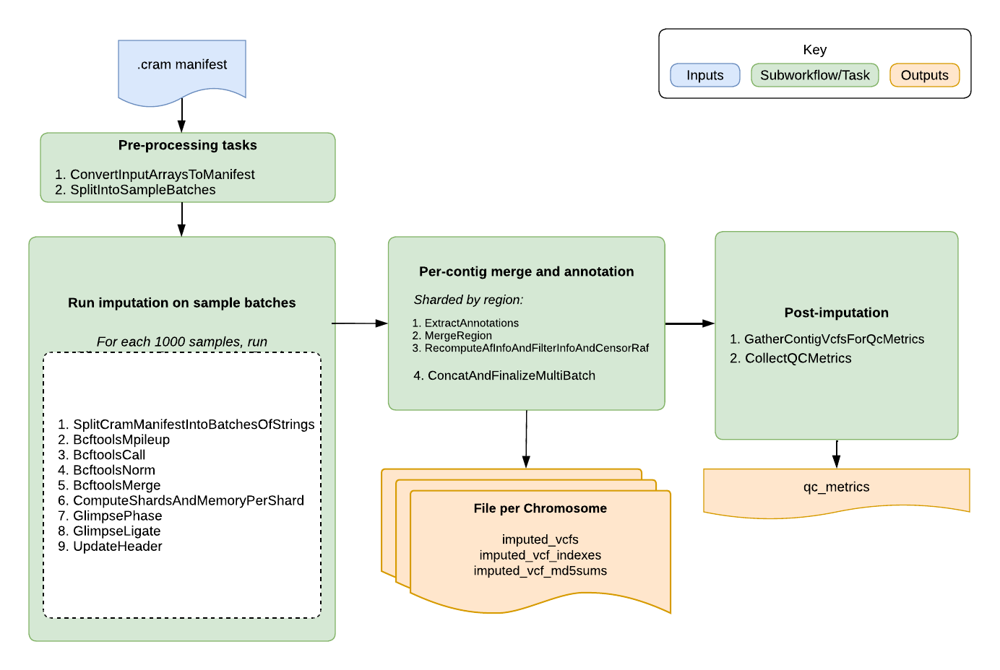

# GLIMPSE2 Low-Pass Imputation Overview

|                                                      Pipeline Version                                                      | Date Updated |        Documentation Author        |                             Questions or Feedback                              |
|:--------------------------------------------------------------------------------------------------------------------------:|:------------:|:----------------------------------:|:------------------------------------------------------------------------------:|
| See [changelog](https://github.com/broadinstitute/warp/blob/develop/pipelines/wdl/glimpse/low_pass_imputation/Glimpse2LowPassImputation.changelog.md) for version information. | See changelog | Terra Scientific Pipeline Services | Please [file an issue in WARP](https://github.com/broadinstitute/warp/issues). | |

## Introduction to the GLIMPSE2 Low-Pass Imputation pipeline
The GLIMPSE2 Low-Pass Imputation pipeline imputes missing genotypes from a list of low-pass CRAM/CRAI files (or a sample manifest pointing to GCS file paths) using a large genomic reference panel. It uses GLIMPSE2 as the imputation tool. Overall, the pipeline splits samples into batches, performs variant calling and imputation on each batch across genomic chunks, and merges the results into a multi-sample VCF per contig. It outputs one imputed VCF per contig, along with key imputation metrics.

## GLIMPSE2 Low-Pass Imputation Summary

The `Glimpse2LowPassImputation` workflow is a WDL-based pipeline for low-pass whole genome imputation using [GLIMPSE2](https://odelaneau.github.io/GLIMPSE/).  
This top-level workflow is now a gateway that scales to large cohorts by splitting samples into batches, running a per-batch imputation subworkflow, then merging batch outputs back into cohort-level results.

The workflow processes each requested contig independently, imputes each sample batch against reference-defined chunks, ligates chunk outputs per batch/contig, merges sample columns across batches, re-headers outputs, optionally filters variants and censors RAF via bcftools piping, recomputes AF/INFO annotations, and returns contig-level indexed file outputs.

### Pipeline Features

| Pipeline features       | Description                                                                                                        | Source                                                                   |
|-------------------------|--------------------------------------------------------------------------------------------------------------------|--------------------------------------------------------------------------|
| Assay type              | Low-pass whole genome imputation using GLIMPSE2                                                                    | [GLIMPSE2](https://odelaneau.github.io/GLIMPSE/)                         |
| Overall workflow        | CRAM calling, shard-based phasing/imputation, ligation, batch merge, inline filtering, and QC                      | Defined in `Glimpse2LowPassImputation.wdl` + imported subworkflows/tasks |
| Workflow language       | WDL 1.0                                                                                                            | [openWDL](https://github.com/openwdl/wdl)                                |
| Sub-workflows           | Gateway workflow + `Glimpse2LowPassImputationBatch`                                                                | Imported from `Glimpse2LowPassImputationBatch.wdl`                       |
| Genomic processing      | Contig-by-contig and reference-chunk-based processing                                                              | Workflow scatter logic                                                   |
| Cohort scalability      | Inputs optionally specified via `cram_manifest`, sample batching (`sample_batch_size`) then per-contig batch merge | Gateway orchestration in `Glimpse2LowPassImputation.wdl`                 |
| Algorithms              | `bcftools` mpileup/call/norm/merge/filter + GLIMPSE2 phase/ligate + post-merge re-annotation                       | Task commands in batch and task WDLs                                     |
| Quality control         | Sample QC metrics and optional coverage-metrics aggregation                                                        | `CollectQCMetrics`, `CombineCoverageMetrics`                             |
| Data input file format  | CRAM/CRAI arrays or a CRAM manifest                                                                                | Workflow input block                                                     |
| Data output file format | Per-contig imputed VCFs, indexes, md5s, and QC metrics                                                            | Workflow outputs                                                         |
| Containers              | GATK, GLIMPSE2, bcftools/samtools suite, Hail, Python, Ubuntu                                                      | Runtime blocks                                                           |
| Resource optimization   | Parallelization by sample batch, contig, and reference shard                                                       | Workflow architecture                                                    |

### Inputs

This gateway workflow expects CRAM-based inputs and a GLIMPSE2-compatible reference panel layout.

| Input | Description |
|----------------------------------|------------------------------------------------------------------------------------------------------------------------------------------------------------------------------------------------------------------------------------------------------------|
| `crams` | Optional array of input CRAM paths. If set, `cram_manifest` is not required. |
| `cram_indices` | Optional array of matching CRAI paths for `crams`. |
| `cram_manifest` | Optional manifest TSV containing at least `cram_path` and `cram_index_path` entries. If both arrays and manifest are supplied, the arrays are used first via `select_first`. |
| `output_basename` | Basename for intermediate and final outputs. |
| `contigs` | Array of contigs/chromosomes to process. |
| `reference_panel_prefix` | Prefix for the reference panel files, ending in `/`; expected files include `sites.<contig>.vcf.gz`, `sites_table.<contig>.gz`, and `reference_chunks.<contig>.txt`. |
| `fasta` | Reference FASTA used for CRAM splitting and calling. |
| `fasta_index` | FASTA index for `fasta`. |
| `ref_dict` | Reference dictionary used when updating VCF headers. |
| `raf_censoring_threshold` | Remove RAF annotations for sites with RAF `<=` this value; default `0.0` (disabled). |
| `info_filter_for_inclusion` | Optional INFO threshold; variants with INFO below this value are excluded from the final output VCF; default `0.0` (disabled). |
| `impute_reference_only_variants` | Whether to impute reference-only variants; default `false`. |
| `call_indels` | Whether to include indels during calling/imputation; default `false`. |
| `calling_batch_size` | Internal calling batch size within each `Glimpse2LowPassImputationBatch` run; default `100`. |
| `sample_batch_size` | Gateway-level batch size used to split large cohorts; default `500`. |
| `glimpse_phase_cpu_override` | Optional override for the GLIMPSE2 phase task CPU count; if unset, the batch workflow defaults to `4` threads. |
| `pipeline_header_line` | Optional extra VCF header line to append to the output headers. |
| `gatk_docker` | Docker image for GATK-based tasks. |
| `glimpse_docker` | Docker image for GLIMPSE2-based tasks. |
| `docker_merge` | Docker image used for VCF merge/re-annotation tasks. |

### Workflow Tasks

The top-level workflow orchestrates batching, per-batch imputation, and cohort-level merging/re-annotation.

| Task / Call | Purpose | Input Dependencies | Key Function |
|------------------------------------------------------|-------------------------------------------------------------------------|--------------------------------------------------------------------------------------------------------|-------------------------------------------------------------------------------------------------|
| `ConvertInputArraysToManifest` | Convert CRAM/CRAI arrays into a manifest | `crams`, `cram_indices` | Allows large input sets to be passed as a manifest |
| `SplitIntoSampleBatches` | Split the manifest into sample-level batches | `cram_manifest_to_use`, `sample_batch_size` | Enables large-cohort scaling at gateway level |
| `RunBatch` (`Glimpse2LowPassImputationBatch`) | Run full low-pass imputation on each batch | Batch manifest + reference inputs + `calling_batch_size` | Produces per-batch, per-contig ligated imputed VCFs |
| `ExtractAnnotations` | Extract AF/INFO annotations from each batch contig VCF | Batch ligated VCFs and indexes | Captures per-batch annotations needed for cohort recomputation |
| `MergeContigVcfs` (`MergeSampleChunksVcfsWithPaste`) | Merge sample columns across batch VCFs for one contig | Array of batch VCFs for a contig | Creates the full-cohort contig VCF |
| `UpdateHeader` (`UpdateHeaderMulti` / `UpdateHeaderSingle`) | Update contig VCF header with reference info and optional pipeline header line | `MergeContigVcfs.output_vcf` or single batch VCF | Prepares normalized metadata before re-annotation and index generation |
| `RecomputeAndAnnotate` | Recompute cohort-level AF/INFO, filter by INFO, censor RAF, and write updated/indexed VCFs | Merged & reheadered contig VCF + extracted annotations + thresholds | Restores cohort-correct annotations after paste-based merge and finalized multi-batch VCF |
| `FilterInfoAndCensorRafAndFinalizeVcf` | Filter variants below INFO, censor RAF, and finalize outputs (Single Batch branch) | Reheadered single-batch VCF + thresholds | Finalizes indexed and filtered outputs for single-batch cohorts |
| `GatherContigVcfsForQcMetrics` | Combine all contig VCFs into one all-chromosome VCF | Output from finalizing tasks | Provides a single VCF to calculate QC metrics |
| `CollectQCMetrics` | Compute cohort-level QC metrics table | `GatherContigVcfsForQcMetrics.output_vcf` | Produces the final QC metrics output |

### Outputs

Upon successful completion, the workflow emits final contig-level imputed outputs, corresponding index and checksum files, and a QC metrics table.

| Output | Description |
|---------------------------|--------------------------------------------------------------------------|
| `imputed_vcfs` | Array of per-contig imputed multi-sample VCFs |
| `imputed_vcf_indexes` | Index files for the per-contig imputed VCFs |
| `imputed_vcf_md5sums` | MD5 checksums for the per-contig imputed VCFs |
| `qc_metrics` | Sample-level QC metrics table computed across all contigs |

## Glimpse2LowPassImputationBatch summary

The `Glimpse2LowPassImputationBatch` workflow is the per-batch subworkflow used by the top-level `Glimpse2LowPassImputation` gateway workflow.  
It is designed for cohorts up to roughly 1000 samples per batch, then returns contig-level ligated imputed VCFs that can be merged across batches upstream.

### Batch Workflow Role

- runs low-pass variant calling from CRAMs at reference-panel sites
- phases/imputes each contig in reference-defined chunks using GLIMPSE2
- ligates chunk-level outputs back into one imputed VCF per contig
- emits optional coverage metrics aggregated across chunks/contigs

### Batch Inputs

| Input | Description |
|----------------------------------|-----------------------------------------------------------------------------------------------------------|
| `contigs` | Contigs/chromosomes to process |
| `reference_panel_prefix` | Prefix containing `sites.<contig>.vcf.gz`, `sites_table.<contig>.gz`, and `reference_chunks.<contig>.txt` |
| `cram_manifest` | TSV file containing CRAM/CRAI paths and sample rows |
| `fasta` / `fasta_index` | Reference FASTA and index |
| `output_basename` | Basename for intermediate and emitted files |
| `impute_reference_only_variants` | Pass-through option for GLIMPSE2 phase |
| `call_indels` | Whether to include indels during calling/imputation |
| `calling_batch_size` | Internal batch size for CRAM calling fan-out within this subworkflow |
| `glimpse_phase_cpu_override` | Optional CPU override passed to the GLIMPSE2 phase task |
| `gatk_docker` / `glimpse_docker` | Container images for GATK and GLIMPSE2 tools |

### Batch Internal Processing

| Step | Purpose |
|-------------------------------------------|----------------------------------------------------------------|
| `SplitCramManifestIntoBatchesOfStrings` | Splits the CRAM manifest into internal calling batches |
| `BcftoolsMpileup` | Computes pileups at panel sites per internal batch |
| `BcftoolsCall` | Calls candidate variants from mpileup output |
| `BcftoolsNorm` | Normalizes and indexes called variants |
| `BcftoolsMerge` (conditional) | Merges per-internal-batch VCFs if multiple were produced |
| `ComputeShardsAndMemoryPerShard` | Reads reference chunks and computes per-shard memory estimates |
| `GlimpsePhase` | Runs `GLIMPSE2_phase` for each reference shard |
| `GlimpseLigate` | Ligates shard outputs to one contig-level imputed VCF |

### Batch Outputs

| Output | Description |
|--------------------------------------|-------------------------------------------------------|
| `imputed_contig_ligated_vcfs` | Per-contig ligated imputed VCFs for this sample batch |
| `imputed_contig_ligated_vcf_indices` | Index files for each contig ligated VCF |
| `total_samples` | Total number of samples represented in the batch |

### Glimpse2MergeBatches AF and INFO score recalculation

As part of the batch merge and re-annotation step in the top-level workflow, we recalculate AF and INFO scores across the full cohort after merging batch VCFs. This is necessary because the batch-level VCFs contain AF/INFO annotations that are only correct for the samples in that batch, so they must be recalculated for the entire input sample set. The logic is implemented in `Glimpse2LowPassImputationTasks.wdl` (`ExtractAnnotations` + `RecomputeAndAnnotate`).

## Glimpse2LowPassImputationQuotaConsumed summary

The `QuotaConsumed` workflow computes submitted sample count for service quota accounting.  
Quota is derived from number of CRAM entries found in the provided CRAM manifest.

## Glimpse2LowPassImputationQC summary

The `InputQC` workflow validates CRAM-based inputs supplied by the `cram_manifest` for GLIMPSE2 low-pass imputation. Checks include:

- required manifest columns are present: `sample_id`, `cram_path`, `cram_index_path`
- counts of CRAMs, CRAIs, and sample IDs match
- sample IDs are unique
- CRAM paths are unique
- CRAM file names end with `.cram` and indices end with `.crai`
- input paths use `gs://` format and are accessible
- CRAM file sizes do not exceed the configured maximum (default: 10 GB)
- CRAM files are aligned to the expected reference
- optional requester-pays validation via `billing_project_for_rp`

## Important notes

- Runtime parameters are optimized for Broad's Google Cloud Platform implementation.

## Citing the Imputation Pipeline

If you use the GLIMPSE2 Low-Pass Imputation Pipeline in your research, please consider citing our preprint:

Degatano, K., Awdeh, A., Cox III, R.S., Dingman, W., Grant, G., Khajouei, F., Kiernan, E., Konwar, K., Mathews, K.L., Palis, K., et al. Warp Analysis Research Pipelines: Cloud-optimized workflows for biological data processing and reproducible analysis. Bioinformatics 2025; btaf494. https://doi.org/10.1093/bioinformatics/btaf494

## Contact us

Help us make our tools better by [filing an issue in WARP](https://github.com/broadinstitute/warp/issues); we welcome pipeline-related suggestions or questions.

## Licensing

Copyright Broad Institute, 2020 | BSD-3

The workflow script is released under the **WDL open source code license (BSD-3)** (full license text at https://github.com/broadinstitute/warp/blob/master/LICENSE). However, please note that the programs it calls may be subject to different licenses. Users are responsible for checking that they are authorized to run all programs before running this script.

- [GATK](https://github.com/broadinstitute/gatk/blob/master/LICENSE.TXT)
- [Picard](https://github.com/broadinstitute/picard/blob/master/LICENSE.txt)
- [GLIMPSE](https://github.com/odelaneau/GLIMPSE/blob/master/LICENSE)
- [bcftools](https://github.com/samtools/bcftools/blob/develop/LICENSE)
- [vcftools](http://vcftools.sourceforge.net/license.html)
