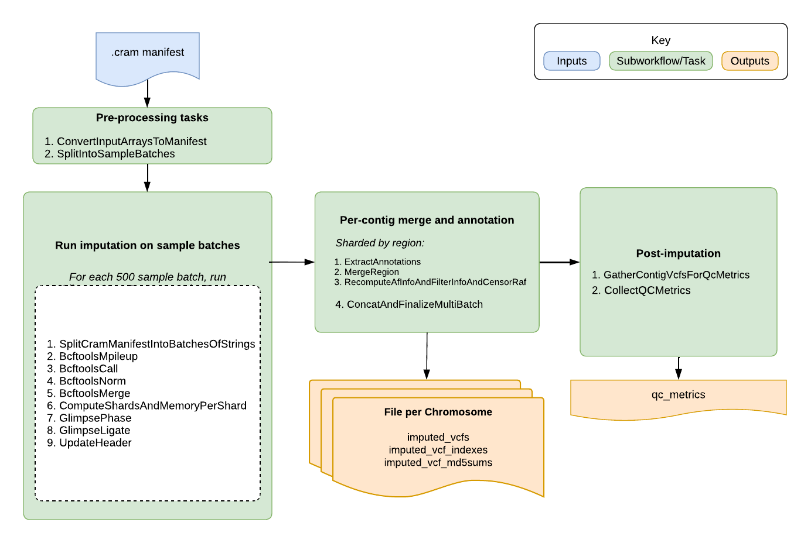

# GLIMPSE2 Low-Pass Imputation Overview

|                                                      Pipeline Version                                                      | Date Updated  |        Documentation Author        |                             Questions or Feedback                              |
|:--------------------------------------------------------------------------------------------------------------------------:|:-------------:|:----------------------------------:|:------------------------------------------------------------------------------:|
| See [changelog](https://github.com/broadinstitute/warp/blob/develop/pipelines/wdl/glimpse/low_pass_imputation/Glimpse2LowPassImputation.changelog.md) for version information. | See changelog | Terra Scientific Pipeline Services | Please [file an issue in WARP](https://github.com/broadinstitute/warp/issues). |

## Introduction to the GLIMPSE2 Low-Pass Imputation pipeline

The GLIMPSE2 Low-Pass Imputation pipeline imputes missing genotypes from a manifest of input low-pass CRAM/CRAI paths (or from CRAM/CRAI arrays that are converted to a manifest) using a large genomic reference panel. It uses `bcftools`-based variant calling, GLIMPSE2-based phasing and ligation, and cohort-aware hierarchical merge/re-annotation to produce final per-contig imputed VCF outputs along with sample-level QC metrics.

## GLIMPSE2 Low-Pass Imputation Summary

The `Glimpse2LowPassImputation` workflow is a WDL-based pipeline for low-pass whole genome imputation using [GLIMPSE2](https://odelaneau.github.io/GLIMPSE/).
This top-level workflow acts as a gateway that scales to large cohorts by splitting samples into batches, running a per-batch imputation subworkflow, then merging per-batch results back into cohort-level per-contig VCFs.

The workflow processes requested contigs independently, calls candidate variants from CRAMs at reference panel sites, phases and ligates imputed chunks, dynamically splits contigs into sub-regions using the FASTA index, hierarchically merges batch sample columns per region, recomputes AF/INFO across all samples, optionally filters by INFO threshold, optionally censors values of RAF below threshold, concatenates regions, and indexes final outputs along with computing sample QC metrics.

### Pipeline Features

| Pipeline features       | Description                                                                                                                | Source                                                                   |
|-------------------------|----------------------------------------------------------------------------------------------------------------------------|--------------------------------------------------------------------------|
| Assay type              | Low-pass whole genome imputation using GLIMPSE2                                                                            | [GLIMPSE2](https://odelaneau.github.io/GLIMPSE/)                         |
| Overall workflow        | Manifest normalization, CRAM calling, chunked phase/ligate, header updates, hierarchical merge, and AF/INFO re-annotation  | Defined in `Glimpse2LowPassImputation.wdl` + imported subworkflows/tasks |
| Workflow language       | WDL 1.0                                                                                                                    | [openWDL](https://github.com/openwdl/wdl)                                |
| Sub-workflows           | Gateway workflow + `Glimpse2LowPassImputationBatch` + `MultilevelHierarchicallyMergeVcfs`                                  | Imported from sibling WDLs in `low_pass_imputation/`                     |
| Genomic processing      | Contig-by-contig processing with nested reference-chunk and postprocessing-region scatters                                 | Workflow scatter logic                                                   |
| Cohort scalability      | Input manifest splitting via `sample_batch_size`, then hierarchical per-contig batch merge                                 | Gateway orchestration in `Glimpse2LowPassImputation.wdl`                 |
| Algorithms              | `bcftools` mpileup/call/norm/merge + GLIMPSE2 phase/ligate + custom paste/concat + cohort AF/INFO recomputation            | Task commands in batch and task WDLs                                     |
| Quality control         | Sample QC metrics                                                                                                          | `CollectQCMetrics`                                                       |
| Data input file format  | CRAM/CRAI manifest or CRAM/CRAI arrays                                                                                     | Workflow input block                                                     |
| Data output file format | Per-contig imputed VCFs, index files, MD5 checksums, and QC metrics                                                        | Workflow outputs                                                         |
| Containers              | GATK, GLIMPSE2, bcftools/samtools, Python, custom imputation Rust tooling containers                                       | Runtime blocks                                                           |
| Resource optimization   | Parallelization by sample batch, contig, reference chunk, and postprocessing shard region                                  | Workflow architecture                                                    |

### Inputs

This gateway workflow expects manifest- or array-based CRAM inputs and a GLIMPSE2-compatible reference panel layout.

| Input | Description |
|----------------------------------|------------------------------------------------------------------------------------------------------------------------------------------------------------------------------------------------------------------------------------------------------------|
| `crams` | Optional array of input CRAM paths. If both arrays and a manifest are supplied, arrays take precedence. |
| `cram_indices` | Optional array of matching CRAI paths for `crams`. |
| `cram_manifest` | Optional manifest TSV used when input arrays are not provided. The workflow expects the manifest to contain `cram_path` and `cram_index_path` columns. |
| `output_basename` | Basename used for intermediate and final outputs. |
| `raf_censoring_threshold` | Remove RAF annotations for sites with RAF `<=` this value; default `0.0` (disabled). |
| `info_filter_for_inclusion` | Optional INFO threshold for variant inclusion; variants with INFO below this value are excluded from the final output VCFs; default `0.0` (disabled). |
| `contigs` | Contigs/chromosomes to process. |
| `reference_panel_prefix` | Prefix for the reference panel files, ending in `/`; expected files include `sites.<contig>.vcf.gz`, `sites_table.<contig>.gz`, and `reference_chunks.<contig>.txt`. |
| `fasta` | Reference FASTA used for CRAM splitting and variant calling. |
| `fasta_index` | FASTA index for `fasta` used for dynamic postprocessing region splitting. |
| `ref_dict` | Reference dictionary used in VCF header updates. |
| `pipeline_header_line` | Optional additional header line added to output VCF headers. |
| `impute_reference_only_variants` | Whether to impute reference-only variants; default `false`. |
| `call_indels` | Whether to include indels during calling/imputation; default `false`. |
| `calling_batch_size` | Internal calling batch size within each `Glimpse2LowPassImputationBatch` run; default `100`. |
| `sample_batch_size` | Number of samples per batch for gateway-level scaling (default: `500`). |
| `postprocessing_shard_size_bp` | Size of genomic shards (in base pairs) for parallelizing postprocessing steps; default `25000000` (25 Mb). |
| `glimpse_phase_cpu_override` | Optional CPU override for GLIMPSE2 chunk phasing. If unset, the batch workflow defaults to `4` threads. |
| `merge_batch_sizes` | Parameterizable batch sizes per hierarchical merge level (default: `[100]`). |
| `merge_do_localization` | Booleans indicating whether to localize input files at each corresponding hierarchical merge level (default: `[true]`). |
| `merge_timeouts_min` | Per-file download timeouts in minutes when streaming at each hierarchical merge level; `0` disables timeout (default: `[0]`). |
| `gatk_docker` | Docker image used for GATK-based tasks. |
| `glimpse_docker` | Docker image used for GLIMPSE2 phasing and ligation tasks. |
| `docker_merge` | Docker image used for annotation extraction and AF/INFO re-annotation tasks. |

### Workflow Tasks

The top-level workflow orchestrates batching, per-batch imputation, and contig-level hierarchical merge/finalization.

| Task / Call | Purpose | Input Dependencies | Key Function |
|------------------------------------------------------------|-----------------------------------------------------------------------------|------------------------------------------------------------------------------------|------------------------------------------------------------------|
| `ConvertInputArraysToManifest` | Convert input CRAM/CRAI arrays into a manifest | `crams`, `cram_indices` | Supports large submissions via manifest abstraction |
| `SplitIntoSampleBatches` (`SplitCramManifestIntoBatches`) | Split the manifest into sample-level batches | `cram_manifest_to_use`, `sample_batch_size` | Enables gateway-level cohort scaling |
| `RunBatch` (`Glimpse2LowPassImputationBatch`) | Run per-batch low-pass calling, chunked phase/ligate, and header generation | Batch manifest + reference inputs + `calling_batch_size` + `ref_dict` | Produces per-batch per-contig ligated BCFs, indexes, and headers |
| `CreateContigRegions` | Generate region shards for scalable parallel merging | `fasta_index`, `contig`, `postprocessing_shard_size_bp` | Parses FASTA index to generate balanced genomic shards |
| `ExtractAnnotations` | Extract AF/INFO annotations from each batch contig BCF in shard regions | Per-batch-and-contig ligated BCF + index + `region` | Captures per-batch-and-shard annotations for cohort recomputation |
| `MergeRegion` (`MultilevelHierarchicallyMergeVcfs`) | Hierarchically merge sample columns across batches for each shard | Arrays of per-batch-and-shard BCFs/indexes + merge configuration | Creates the full-cohort shard BCF |
| `RecomputeAfInfoAndFilterInfoAndCensorRaf` (`RecomputeAndAnnotate`) | Recompute AF/INFO across the merged cohort and re-annotate for each shard and optionally filter by INFO and censor RAF | Merged per-shard BCF + annotations + sample counts + INFO and RAF thresholds | Restores cohort-correct AF/INFO values |
| `ConcatAndFinalizeMultiBatch` (`ConcatAndFinalizeVcfs`) | Concat shards, apply updated header, and finalize VCF/index/md5 outputs | Per-shard re-annotated+filtered+censored VCFs + `updated_header` | Emits `concatenated_vcf`, index, and md5sum per contig |
| `FilterInfoAndCensorRafAndFinalizeVcf` | Optionally filter by INFO and censor RAF, apply updated header, and finalize VCF/index/md5 outputs for single batches | Ligated contig BCF + index + thresholds + `updated_header` | Emits `filtered_vcf`, index, and md5sum per contig |
| `GatherContigVcfsForQcMetrics` (`GatherVcfsNoIndex`) | Combine all finalized contig VCFs into one all-chromosome VCF | `finalized_contig_vcf` array | Provides a single VCF to calculate QC metrics |
| `CollectQCMetrics` | Compute cohort-level QC metrics table | `GatherContigVcfsForQcMetrics.output_vcf` | Produces the final `qc_metrics` output |

### Outputs

Upon successful completion, the workflow emits final per-contig imputed outputs, matching indexes and MD5 checksums, and a QC metrics table.

| Output | Description |
|-----------------------|------------------------------------------------------------|
| `imputed_vcfs` | Final per-contig imputed multi-sample VCF files |
| `imputed_vcf_indexes` | Index files for final per-contig imputed VCF files |
| `imputed_vcf_md5sums` | MD5 checksums for final per-contig imputed VCF files |
| `qc_metrics` | Sample-level QC metrics table computed across all contigs |

## Glimpse2LowPassImputationBatch summary

The `Glimpse2LowPassImputationBatch` workflow is the per-batch subworkflow used by `Glimpse2LowPassImputation`. It is designed for cohorts up to roughly 1000 samples per batch, running variant calling from CRAMs and contig-level chunked phasing, ligation, and header generation for upstream cohort merge.

### Batch internal processing

| Step | Purpose |
|-------------------------------------------|----------------------------------------------------------------|
| `SplitCramManifestIntoBatchesOfStrings` | Splits the CRAM manifest into internal calling batches |
| `BcftoolsMpileup` | Computes pileups at panel sites per internal batch |
| `BcftoolsCall` | Calls candidate variants from mpileup output |
| `BcftoolsNorm` | Normalizes and indexes called variants |
| `BcftoolsMerge` (conditional) | Merges per-internal-batch VCFs if multiple were produced |
| `ComputeShardsAndMemoryPerShard` | Reads reference chunks and computes per-shard memory estimates |
| `GlimpsePhase` | Runs `GLIMPSE2_phase` for each reference shard |
| `GlimpseLigate` | Ligates shard outputs to one contig-level imputed BCF |
| `UpdateHeader` | Generates updated VCF headers with reference dictionary and optional pipeline line |

### Batch outputs

| Output | Description |
|--------------------------------------|----------------------------------------------------------------|
| `imputed_contig_ligated_bcfs` | Per-contig ligated imputed BCFs for this sample batch |
| `imputed_contig_ligated_bcf_indices` | Indexes for contig ligated BCF outputs |
| `updated_headers` | Updated VCF header files per contig |
| `total_samples` | Total number of samples represented in the batch |

## LowPassMultilevelHierarchicallyPasteVcfsStreaming summary

The `MultilevelHierarchicallyMergeVcfs` workflow (defined in `LowPassMultilevelHierarchicallyPasteVcfsStreaming.wdl`) provides scalable multi-level merging for squared-off VCF/BCF inputs across sample batches. It performs region-first hierarchical batching, optional streaming/localization, and final region concatenation.

### MultilevelHierarchicallyMergeVcfs internal processing

| Step | Purpose |
|----------------------------|----------------------------------------------------------------------|
| `CreateBatches` (L0/L1/L2) | Split input files into hierarchical batch groups |
| `MergeVcfs` (L0/L1/L2) | Merge each batch within each region with optional streaming timeouts |
| `FinalRegionMerge` | Collapse remaining per-region intermediate files when needed |
| `ConcatBcfs` | Concatenate finalized region outputs into one merged BCF |

### MultilevelHierarchicallyMergeVcfs outputs

| Output | Description |
|------------------|-------------------------------------------------------|
| `merged_bcf` | Final merged BCF across all input samples and regions |
| `merged_bcf_idx` | Index for `merged_bcf` |

## Glimpse2LowPassImputationQuotaConsumed summary

The `QuotaConsumed` workflow computes submitted sample count for service quota accounting from `cram_manifest`.

## Glimpse2LowPassImputationQC summary

The `InputQC` workflow validates manifest-level and CRAM-level readiness before low-pass imputation.

### InputQC checks

- required manifest columns are present: `cram_path`, `cram_index_path`
- counts of CRAMs and CRAIs match
- sample IDs are unique
- CRAM paths are unique
- CRAM file names end with `.cram` and indices end with `.crai`
- input paths use `gs://` format and are accessible
- CRAM file sizes do not exceed the configured maximum (default: `10 GB`)
- CRAM files are aligned to the expected reference
- optional requester-pays validation via `billing_project_for_rp`

## Important notes

- Runtime parameters are optimized for Broad's Google Cloud Platform implementation.

## Citing the Imputation Pipeline

If you use the GLIMPSE2 Low-Pass Imputation Pipeline in your research, please consider citing our preprint:

Degatano, K., Awdeh, A., Cox III, R.S., Dingman, W., Grant, G., Khajouei, F., Kiernan, E., Konwar, K., Mathews, K.L., Palis, K., et al. Warp Analysis Research Pipelines: Cloud-optimized workflows for biological data processing and reproducible analysis. Bioinformatics 2025; btaf494. https://doi.org/10.1093/bioinformatics/btaf494

## Contact us

Help us make our tools better by [filing an issue in WARP](https://github.com/broadinstitute/warp/issues); we welcome pipeline-related suggestions or questions.

## Licensing

Copyright Broad Institute, 2020 | BSD-3

The workflow script is released under the **WDL open source code license (BSD-3)** (full license text at https://github.com/broadinstitute/warp/blob/master/LICENSE). However, please note that the programs it calls may be subject to different licenses. Users are responsible for checking that they are authorized to run all programs before running this script.

- [GATK](https://github.com/broadinstitute/gatk/blob/master/LICENSE.TXT)
- [Picard](https://github.com/broadinstitute/picard/blob/master/LICENSE.txt)
- [GLIMPSE](https://github.com/odelaneau/GLIMPSE/blob/master/LICENSE)
- [bcftools](https://github.com/samtools/bcftools/blob/develop/LICENSE)
- [vcftools](http://vcftools.sourceforge.net/license.html)
