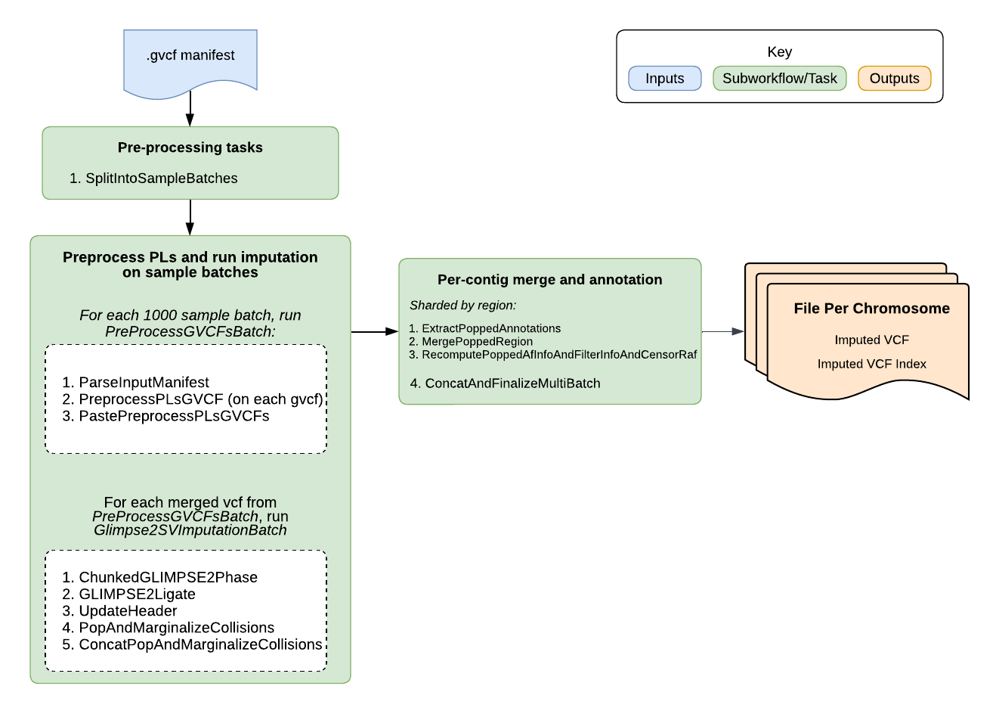

# GLIMPSE2 SV Imputation Overview

|                                                                          Pipeline Version                                                                           | Date Updated  |        Documentation Author        |                             Questions or Feedback                              |
|:-------------------------------------------------------------------------------------------------------------------------------------------------------------------:|:-------------:|:----------------------------------:|:------------------------------------------------------------------------------:|
| See [changelog](https://github.com/broadinstitute/warp/blob/develop/pipelines/wdl/glimpse/sv_imputation/Glimpse2SVImputation.changelog.md) for version information. | See changelog | Terra Scientific Pipeline Services | Please [file an issue in WARP](https://github.com/broadinstitute/warp/issues). |

## Introduction to the GLIMPSE2 SV Imputation pipeline

The GLIMPSE2 SV Imputation pipeline imputes structural variants, SNPs, and INDELs from a manifest of input GVCF paths (or from GVCF/index arrays that are converted to a manifest). It uses GLIMPSE2-based phasing, panel-informed bubble processing, and cohort-aware hierarchical merge/re-annotation to produce final per-contig imputed VCF outputs.

## GLIMPSE2 SV Imputation Summary

The `Glimpse2SVImputation` workflow is a WDL-based pipeline for structural variant imputation using [GLIMPSE2](https://odelaneau.github.io/GLIMPSE/).
This top-level workflow acts as a gateway that scales to large cohorts by splitting samples into batches, running preprocess + batch imputation subworkflows per batch, then merging per-batch results back into cohort-level per-contig VCFs.

The workflow processes requested chromosomes independently, extracts/reformats bubble likelihoods, phases and ligates imputed chunks, pops/marginalizes collisions, hierarchically merges batch sample columns per region, recomputes AF/INFO across all samples, optionally filters by INFO threshold, optionally censors values of RAF below threshold, concatenates regions, and indexes final outputs.

### Pipeline Features

| Pipeline features       | Description                                                                                                    | Source                                                              |
|-------------------------|----------------------------------------------------------------------------------------------------------------|---------------------------------------------------------------------|
| Assay type              | Structural variant imputation using GLIMPSE2                                                                   | [GLIMPSE2](https://odelaneau.github.io/GLIMPSE/)                    |
| Overall workflow        | Manifest normalization, preprocessing, chunked phase/ligate, pop/marginalize, merge, and AF/INFO re-annotation | Defined in `Glimpse2SVImputation.wdl` + imported subworkflows/tasks |
| Workflow language       | WDL 1.0                                                                                                        | [openWDL](https://github.com/openwdl/wdl)                           |
| Sub-workflows           | Gateway workflow + `PreprocessPLsGVCF` + `Glimpse2SVImputationBatch` + `MultilevelHierarchicallyMergeVcfs`     | Imported from sibling WDLs in `sv_imputation/`                      |
| Genomic processing      | Contig-by-contig processing with nested shard/region scatters                                                  | Workflow scatter logic                                              |
| Cohort scalability      | Input manifest splitting via `sample_batch_size`, then hierarchical batch-level contig merge                   | Gateway orchestration                                               |
| Algorithms              | GLIMPSE2 phase/ligate + custom paste/concat + cohort AF/INFO recomputation                                     | Task commands in batch/task WDLs                                    |
| Data input file format  | GVCF/GVCF index manifest or GVCF/index arrays                                                                  | Workflow input block                                                |
| Data output file format | Per-contig imputed VCFs with index files                                                                       | Workflow outputs                                                    |
| Containers              | GLIMPSE2, bcftools/samtools, Python, custom SV tooling containers                                              | Runtime blocks                                                      |
| Resource optimization   | Parallelization by sample batch, chromosome, chunk, and pop region                                             | Workflow architecture                                               |

### Inputs

This gateway workflow expects manifest- or array-based GVCF inputs plus SV panel/chunk resources.

| Input | Description |
|---------------------------------------------------------|----------------------------------------------------------------------------------------------------------------------------|
| `input_gvcfs` | Optional array of input GVCF paths. If both arrays (`input_gvcfs` and `input_gvcf_idxs`) and a manifest are supplied, arrays take precedence. |
| `input_gvcf_idxs` | Optional array of matching GVCF index paths for `input_gvcfs`. |
| `gvcf_manifest` | Optional manifest TSV used when input arrays are not provided. The workflow expects the manifest to contain `gvcf_path` and `gvcf_index_path` columns. |
| `sample_batch_size` | Number of samples per batch for gateway-level scaling (default: `1000`). |
| `output_basename` | Basename used for intermediate and final outputs. |
| `preprocess_panel_bubble_split_sites_only_vcf` | Panel VCF used in the preprocessing stage for bubble extraction. |
| `preprocess_panel_bubble_split_sites_only_vcf_idx` | Index for `preprocess_panel_bubble_split_sites_only_vcf`. |
| `extract_bubble_likelihoods_extra_args` | Optional extra arguments passed to the preprocessing step. |
| `paste_regions` | Regions passed to the hierarchical merge in the preprocessing step. |
| `chromosomes` | Chromosomes/contigs to process. |
| `genetic_maps_tsv` | TSV mapping contig names to GLIMPSE2 genetic map files. |
| `ref_dict` | Reference dictionary used in header updates. |
| `chunked_panel_json` | JSON describing chunk bins and regions by chromosome. |
| `extra_phase_args` | Command-line arguments passed to `GLIMPSE2_phase`. Default value is the default in the workflow input block. |
| `glimpse_phase_cpu_override` | Optional CPU override for GLIMPSE2 chunk phasing. If unset, the batch workflow defaults to `4` threads. |
| `pop_glimpse2_panel_resources_json` | JSON containing panel resources used in pop/marginalize processing. |
| `merge_batch_sizes` | Parameterizable batch sizes per hierarchical merge level (default: `[100]`). |
| `merge_do_localization` | Booleans indicating whether to localize input files at each corresponding hierarchical merge level (default: `[true]`). |
| `merge_timeouts_min` | Per-file download timeouts in minutes when streaming at each hierarchical merge level; `0` disables timeout (default: `[0]`). |
| `info_filter_for_inclusion` | Optional INFO threshold for variant inclusion; default `0.0` (disabled). |
| `raf_censoring_threshold` | Remove RAF annotations for sites with RAF `<=` this value; default `0.0` (disabled). |
| `pipeline_header_line` | Optional additional header line added to output VCF headers. |
| `glimpse2_docker` | Docker image used for GLIMPSE2 phases and ligation tasks. |

### Workflow Tasks

The top-level workflow orchestrates batching, per-batch preprocessing/imputation, and contig-level merge/finalization.

| Task / Call | Purpose | Input Dependencies | Key Function |
|------------------------------------------------------------|------------------------------------------------------------|---------------------------------------------------------|---------------------------------------------------------|
| `ConvertInputArraysToManifest` | Convert input GVCF/index arrays into a manifest | `input_gvcfs`, `input_gvcf_idxs` | Supports large submissions via manifest abstraction |
| `SplitIntoSampleBatches` (`SplitVcfManifestIntoBatches`) | Split the manifest into sample-level batches | `gvcf_manifest_to_use`, `sample_batch_size` | Enables gateway-level cohort scaling |
| `PreProcessGVCFsBatch` (`PreprocessPLsGVCF`) | Preprocess one batch of GVCFs into a merged BCF | Batch manifest + preprocessing resources | Produces one preprocessed BCF/index per batch |
| `RunBatch` (`Glimpse2SVImputationBatch`) | Run per-batch chunked SV phase/ligate/pop processing | Preprocessed BCF + chromosome/map/chunk/panel resources | Produces per-batch per-contig popped posterior BCFs |
| `ExtractPoppedAnnotations` (`ExtractAnnotations`) | Extract AF/INFO annotations from each batch contig BCF in shard regions | Per-batch-and-contig popped BCF + index + `region` | Captures per-batch-and-shard annotations for cohort recomputation |
| `MergePoppedRegion` (`MultilevelHierarchicallyMergeVcfs`) | Hierarchically merge sample columns across batches for each shard | Arrays of per-batch-and-contig popped BCFs/indexes + `region` + merge configuration | Creates the full-cohort shard BCF |
| `RecomputePoppedAfInfoAndFilterInfoAndCensorRaf` (`RecomputeAndAnnotate`) | Recompute AF/INFO across the merged cohort and re-annotate for each shard and optionally filter by INFO and censor RAF | Merged per-shard BCF + annotations + sample counts + INFO and RAF thresholds | Restores cohort-correct AF/INFO values |
| `ConcatAndFinalizeMultiBatch` (`ConcatAndFinalizeVcfs`) | Concat shards and finalize VCF/index outputs | Per-shard re-annotated+filtered+censored VCFs | Emits `concatenated_vcf` and `concatenated_vcf_idx` per contig |
| `FilterInfoAndCensorRafAndFinalizeBcf` | Optionally filter by INFO and censor RAF and then finalize VCF/index outputs for single batches | Popped contig BCF + index + thresholds | Emits `filtered_vcf` and `filtered_vcf_idx` per contig |

### Outputs

Upon successful completion, the workflow emits final per-contig imputed outputs and matching indexes.

| Output | Description |
|-----------------------|----------------------------------------------------|
| `imputed_vcfs` | Final per-contig imputed VCF files |
| `imputed_vcf_indexes` | Index files for final per-contig imputed VCF files |

## PreprocessPLsGVCF summary

The `PreprocessPLsGVCF` workflow preprocesses each input GVCF in a batch and hierarchically merges all preprocessed outputs into a single batch-level BCF for downstream GLIMPSE2 phasing.

### PreprocessPLsGVCF internal processing

| Step | Purpose |
|-----------------------------------------------------------------|-------------------------------------------------------------------|
| `ParseInputManifest` (`ParseVcfManifestIntoArrays`) | Parse the batch manifest into arrays of GVCF paths and index paths |
| `PreprocessPLsGVCF` scatter (`PreprocessPLs`) | Run per-sample `extract-bubble-PLs` to generate preprocessed BCFs |
| `PastePreprocessPLsGVCFs` (`MultilevelHierarchicallyMergeVcfs`) | Hierarchically merge preprocessed BCFs across configured regions |

### PreprocessPLsGVCF outputs

| Output | Description |
|----------------------------|--------------------------------------------|
| `preprocessed_pls_bcf` | Batch-level merged preprocessed BCF |
| `preprocessed_pls_bcf_idx` | Index for `preprocessed_pls_bcf` |
| `num_samples` | Number of samples represented in the batch |

## Glimpse2SVImputationBatch summary

The `Glimpse2SVImputationBatch` workflow is the per-batch subworkflow used by `Glimpse2SVImputation`. It takes one preprocessed batch BCF and runs chromosome-level chunked phasing, ligation, header normalization, and pop/marginalize post-processing.

### Batch internal processing

| Step | Purpose |
|----------------------------------------------------|--------------------------------------------------------------------------|
| `ChunkedGLIMPSE2Phase` | Run `GLIMPSE2_phase` over each chunk for each chromosome |
| `GLIMPSE2Ligate` | Ligate chunk-level phased outputs into one chromosome-level BCF |
| `UpdateHeader` | Rebuild/update headers with dictionary and optional pipeline line |
| `PopAndMarginalizeCollisions` | Apply pop/marginalize processing over one or more regions per chromosome |
| `ConcatPopAndMarginalizeCollisions` (`ConcatBcfs`) | Concatenate regional popped BCFs into one popped BCF per chromosome |

### Batch outputs

| Output | Description |
|--------------------------------------|------------------------------------------------------------|
| `glimpse2_bubble_posteriors_vcf` | Per-chromosome post-ligation BCFs with updated headers |
| `glimpse2_bubble_posteriors_vcf_idx` | Indexes for bubble posterior outputs |
| `glimpse2_popped_posteriors_vcf` | Final per-chromosome popped BCFs for upstream cohort merge |
| `glimpse2_popped_posteriors_vcf_idx` | Indexes for popped posterior outputs |

## MultilevelHierarchicallyPasteVcfsStreaming summary

The `MultilevelHierarchicallyMergeVcfs` workflow (defined in `MultilevelHierarchicallyPasteVcfsStreaming.wdl`) provides scalable multi-level merging for squared-off VCF/BCF inputs—both single-sample preprocessed BCFs (in `PreprocessPLsGVCF`) and per-batch BCFs across cohorts (in `MergePoppedRegion`). It performs region-first hierarchical batching, optional streaming/localization, and final region concatenation.

### MultilevelHierarchicallyMergeVcfs internal processing

| Step | Purpose |
|----------------------------|----------------------------------------------------------------------|
| `CreateBatches` (L0/L1/L2) | Split input files into hierarchical batch groups |
| `MergeVcfs` (L0/L1/L2) | Merge each batch within each region with optional streaming timeouts |
| `FinalRegionMerge` | Collapse remaining per-region intermediate files when needed |
| `ConcatBcfs` | Concatenate finalized region outputs into one merged BCF |

### MultilevelHierarchicallyMergeVcfs outputs

| Output | Description |
|------------------|-------------------------------------------------------|
| `merged_bcf` | Final merged BCF across all input samples and regions |
| `merged_bcf_idx` | Index for `merged_bcf` |

## Glimpse2SVImputationQuotaConsumed summary

The `QuotaConsumed` workflow computes submitted sample count for service quota accounting from `gvcf_manifest`.

### QuotaConsumed internal processing

| Step | Purpose |
|--------------------------|----------------------------------------------------------------|
| `CountGvcfsFromManifest` | Count GVCF entries in the manifest and report `quota_consumed` |

### QuotaConsumed outputs

| Output | Description |
|------------------|------------------------------------------------------------|
| `quota_consumed` | Number of submitted GVCF entries counted from the manifest |

## Glimpse2SVImputationQC summary

The `InputQC` workflow validates manifest-level and GVCF-level readiness before SV imputation.

### InputQC checks

- required manifest columns are present: `gvcf_path`, `gvcf_index_path`
- manifest has at least one row and no empty required values
- GVCF paths are unique
- GVCF and index extensions are valid (`.vcf.gz`/`.gvcf.gz` and `.tbi`)
- GVCF and index basenames are matched
- paths use valid `gs://` format and are accessible
- GVCF file size is below the configured threshold (default `10 GB`)
- GVCF headers are compatible with the expected reference dictionary
- each GVCF contains exactly one sample
- sample IDs are unique across all provided GVCFs
- PL and GT FORMAT IDs are present in each GVCF header
- each GVCF is vcf version 4.x

### InputQC outputs

| Output | Description |
|---------------|-------------------------------------------------------|
| `passes_qc` | Overall QC pass/fail status |
| `qc_messages` | Aggregated QC failure messages (empty when QC passes) |

## Important notes

- Runtime parameters are optimized for Broad's Google Cloud Platform implementation.

## Contact us

Help us make our tools better by [filing an issue in WARP](https://github.com/broadinstitute/warp/issues); we welcome pipeline-related suggestions or questions.