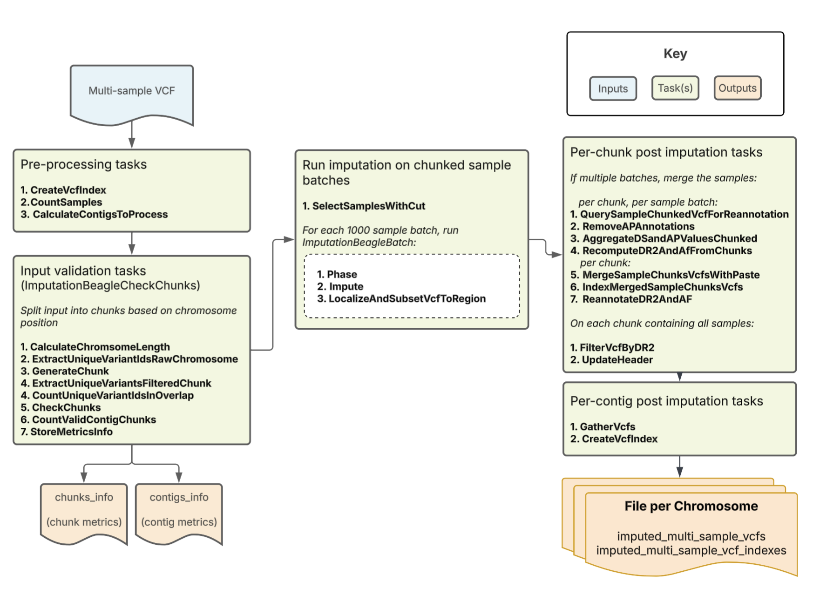

# Imputation Overview

|                                                  Pipeline Version                                                  | Date Updated |        Documentation Author        |                             Questions or Feedback                              |
|:------------------------------------------------------------------------------------------------------------------:|:------------:|:----------------------------------:|:------------------------------------------------------------------------------:|
| See [changelog](https://github.com/broadinstitute/warp/blob/develop/pipelines/wdl/arrays/imputation_beagle/ImputationBeagle.changelog.md) for version information. | See changelog | Terra Scientific Pipeline Services | Please [file an issue in WARP](https://github.com/broadinstitute/warp/issues). | |

## Introduction to the Array Imputation pipeline

The Array Imputation pipeline imputes missing genotypes from a multi-sample VCF using a large genomic reference panel. It uses [Beagle](https://faculty.washington.edu/browning/beagle/beagle.html) for phasing and imputation. The workflow chunks each requested contig, validates each chunk against the reference panel, phases/imputes each sample chunk, strips overlap regions, merges sample chunks back together, and emits per-contig imputed VCFs with QC summaries.

## Set-up

### Workflow installation and requirements

The [Array Imputation workflow](https://github.com/broadinstitute/warp/blob/develop/pipelines/wdl/arrays/imputation_beagle/ImputationBeagle.wdl) is written in the Workflow Description Language (WDL) and can be deployed using a WDL-compatible execution engine like [Cromwell](https://github.com/broadinstitute/cromwell), a GA4GH-compliant workflow manager that supports multiple computing platforms.

To identify the latest workflow version and release notes, see the Imputation workflow [changelog](https://github.com/broadinstitute/warp/blob/develop/pipelines/wdl/arrays/imputation_beagle/ImputationBeagle.changelog.md).

### Using the Array Imputation pipeline

This pipeline is used by the [All of Us + AnVIL Imputation Service](http://allofus-anvil-imputation.terra.bio). If you choose to use this service, you can impute your samples against the reference panel hosted in cloud storage.

:::tip Try the Imputation pipeline in Terra
You can alternatively run the pipeline with your own panel, using this [WDL](https://github.com/broadinstitute/warp/blob/develop/pipelines/wdl/arrays/imputation_beagle/ImputationBeagle.wdl).
:::

### Input descriptions

The table below describes the Array Imputation pipeline inputs. The workflow requires a multi-sample VCF and a reference-panel layout for the contigs being processed.

For examples of how to specify each input in a configuration file, see the [example input JSONs](https://github.com/broadinstitute/warp/tree/develop/pipelines/wdl/arrays/imputation_beagle/test_inputs).

| Input name | Description | Type |
|-----------------------------|----------------------------------------------------------------------------------------------------------|------------------|
| `multi_sample_vcf` | Multi-sample VCF file containing genotype data. | `File` |
| `ref_dict` | Reference dictionary used to calculate contig lengths and update VCF headers. | `File` |
| `contigs` | Allowed contigs/chromosomes to process. The workflow filters the input VCF to these contigs. | `Array[String]` |
| `reference_panel_path_prefix` | Prefix to the reference panel files for all contigs (e.g. `.../panel.<chr>`). | `String` |
| `genetic_maps_path` | Prefix to the genetic map files for all contigs. | `String` |
| `output_basename` | Basename used for intermediate and final outputs. | `String` |
| `chunkLength` | Size of each genomic chunk in base pairs; default `25000000`. | `Int` |
| `chunkOverlaps` | Padding added to each chunk to reduce edge effects; default `2000000`. | `Int` |
| `sample_chunk_size` | Number of samples processed per imputation sample chunk; default `1000`. | `Int` |
| `pipeline_header_line` | Optional additional VCF header line to append to output VCFs. | `String?` |
| `min_dr2_for_inclusion` | Minimum DR2 threshold to include a variant in the final output VCF; default `0.0` (disabled). | `Float?` |
| `bref3_suffix` | Suffix used for reference panel `.bref3` files; default `.bref3`. | `String` |
| `unique_variant_ids_suffix` | Suffix used for per-contig unique-variant ID files; default `.unique_variants`. | `String` |
| `gatk_docker` | Docker image used by GATK-based tasks; default `us.gcr.io/broad-gatk/gatk:4.6.0.0`. | `String` |
| `ubuntu_docker` | Docker image used for dictionary/utility tasks; default `us.gcr.io/broad-dsde-methods/ubuntu:20.04`. | `String` |
| `error_count_override` | Optional override for QC failure count; set to `0` to continue despite failed chunks. | `Int?` |
| `beagle_cpu` | Beagle CPU count for phase/impute tasks; default `8`. | `Int` |
| `beagle_phase_memory_in_gb` | Memory for Beagle phase step; default `40`. | `Int` |
| `beagle_impute_memory_in_gb` | Memory for Beagle impute step; default `45`. | `Int` |
| `merge_sample_chunks_vcfs_with_paste_preemptible_sample_cutoff` | Sample-count cutoff for setting `preemptible = 0` on `MergeSampleChunksVcfsWithPaste`; default `10000`. | `Int` |
| `aggregate_chunked_dr2_and_af_preemptible_sample_cutoff` | Sample-count cutoff for setting `preemptible = 0` on `AggregateChunkedDR2AndAF`; default `30000`. | `Int` |
| `reannotate_dr2_and_af` | Sample-count cutoff for setting `preemptible = 0` on `ReannotateDR2AndAF`; default `4000`. | `Int` |

## Workflow tasks and tools

The [Array Imputation workflow](https://github.com/broadinstitute/warp/blob/develop/pipelines/wdl/arrays/imputation_beagle/ImputationBeagle.wdl) imports tasks from `ImputationTasks.wdl` and `ImputationBeagleTasks.wdl`, both hosted under the Broad tasks library. The table below summarizes the workflow tasks and their roles.

| Task name (alias) in WDL | Tool | Software | Description |
|------------------------------------------|----------------------------------------------------------------|------------------------------------|-----------------------------------------------------------------------------------------------------------------------------------------------------------------------------------------------------------------------------------------------------------------------------------------------------------------------------------|
| `CreateVcfIndex` | index | bcftools | Indexes the input multi-sample VCF so later tasks can query and subset it efficiently. |
| `CountSamples` | query | bcftools | Counts the number of samples in the input VCF to drive sample-chunking and resource sizing. |
| `CalculateContigsToProcess` | custom script | Python / bash | Determines which contigs in the input VCF are eligible for imputation based on the workflow `contigs` input. |
| `CalculateChromosomeLength` | grep / bash | bash | Reads chromosome lengths from the reference dictionary and derives chunk bounds for each contig. |
| `ExtractUniqueVariantIds` | SelectVariants + query | GATK + bcftools | Extracts unique CHROM:POS:REF:ALT identifiers for a contig or chunk to compare against the reference panel. |
| `CountUniqueVariantIdsInOverlap` | comm | bash | Counts the overlap between filtered chunk variants and the panel’s unique variant IDs. |
| `CheckChunks` | custom validation | bcftools / bash | Validates the chunk QC check and marks chunks with insufficient overlap or too few variants. |
| `CountValidContigChunks` | bash | bash | Counts invalid chunks so the workflow can fail early if QC is not acceptable. |
| `FailQCNChunks` (`ErrorWithMessageIfErrorCountNotZero`) | bash | bash | Stops the workflow if the number of failed chunks is non-zero, unless overridden. |
| `SelectSamplesWithCut` | cut | bash | Splits a chunked VCF by sample chunks when `sample_chunk_size` requires a scatter by sample. |
| `Phase` | Beagle | Beagle | Phases the filtered chunk using the reference panel and genetic map. |
| `Impute` | Beagle | Beagle | Performs Beagle imputation for the phased chunk. |
| `LocalizeAndSubsetVcfToRegion` | SelectVariants | GATK | Removes the overlap padding from each imputed chunk so that only the intended genomic interval remains. |
| `QuerySampleChunkedVcfForReannotation` | query | bcftools | Extracts the DS/AP annotations needed to recompute DR2 and AF after sample-chunk merging. |
| `RemoveAPAnnotations` | annotate | bcftools | Removes AP annotations after the chunk-level reannotation step to reduce file size. |
| `RecalculateDR2AndAFChunked` | Python | Python | Recomputes DR2 and AF for each sample-chunked VCF using the query output. |
| `MergeSampleChunksVcfsWithPaste` | Paste + view | bash + bcftools | Merges per-sample-chunk VCFs back together by pasting sample columns. |
| `IndexMergedSampleChunksVcfs` | index | bcftools | Builds the VCF index for the merged sample-chunk result. |
| `AggregateChunkedDR2AndAF` | Python | Python | Combines the per-sample-chunk DR2/AF summary files into a single annotation table. |
| `ReannotateDR2AndAF` | annotate | bcftools | Adds the merged DR2/AF values back to the sample-merged VCF. |
| `FilterVcfByDR2` | filter | GATK | Removes variants below the `min_dr2_for_inclusion` threshold when a threshold is supplied. |
| `UpdateHeader` | UpdateVCFSequenceDictionary | GATK | Updates the VCF header with the reference dictionary and any optional pipeline header line. |
| `GatherVcfsNoIndex` | Combine VCFs | bcftools | Merges the per-chunk VCFs for a contig into a single contig-level VCF. |
| `CreateIndexForGatheredVcfContig` | index | bcftools | Creates the index for the final per-contig VCF. |
| `StoreMetricsInfo` | Python / pandas | Python | Aggregates chunk- and contig-level variant QC metrics into the final metrics tables. |

## Workflow outputs

The table below summarizes the workflow outputs. These appear as arrays of per-contig VCFs and QC metrics tables.

| Output name | Description | Type |
|--------------------------------------|----------------------------------------------------------------------------------------------------------------------------------------------------------------------------------------------------------|-------|
| `imputed_multi_sample_vcfs` | Final imputed multi-sample VCFs, one per contig. | `Array[File]` |
| `imputed_multi_sample_vcf_indexes` | Index files for the per-contig imputed VCFs. | `Array[File]` |
| `chunks_info` | TSV produced by `StoreMetricsInfo` containing chunk-level intervals, variant counts, and pass/fail status for each chunk. | `File` |
| `contigs_info` | TSV produced by `StoreMetricsInfo` containing contig-level summary metrics for the processed chromosomes. | `File` |

## Important notes

- Runtime parameters are optimized for Broad's Google Cloud Platform implementation.
- The workflow fails early when a chunk fails the reference-panel overlap QC, unless `error_count_override` is set to permit continuation.
- When processing many samples, the workflow splits by sample chunk and merges the outputs after recomputing DR2/AF annotations.

## Citing the Imputation Pipeline

If you use the Imputation Pipeline in your research, please consider citing our preprint:

Degatano, K., Awdeh, A., Cox III, R.S., Dingman, W., Grant, G., Khajouei, F., Kiernan, E., Konwar, K., Mathews, K.L., Palis, K., et al. Warp Analysis Research Pipelines: Cloud-optimized workflows for biological data processing and reproducible analysis. Bioinformatics 2025; btaf494. https://doi.org/10.1093/bioinformatics/btaf494

## Contact us

Help us make our tools better by [filing an issue in WARP](https://github.com/broadinstitute/warp/issues); we welcome pipeline-related suggestions or questions.

## Licensing

Copyright Broad Institute, 2020 | BSD-3

The workflow script is released under the **WDL open source code license (BSD-3)** (full license text at https://github.com/broadinstitute/warp/blob/master/LICENSE). However, please note that the programs it calls may be subject to different licenses. Users are responsible for checking that they are authorized to run all programs before running this script.

- [GATK](https://github.com/broadinstitute/gatk/blob/master/LICENSE.TXT)
- [Picard](https://github.com/broadinstitute/picard/blob/master/LICENSE.txt)
- [Beagle](https://faculty.washington.edu/browning/beagle/beagle.html)
- [bcftools](https://github.com/samtools/bcftools/blob/develop/LICENSE)
- [vcftools](http://vcftools.sourceforge.net/license.html)

